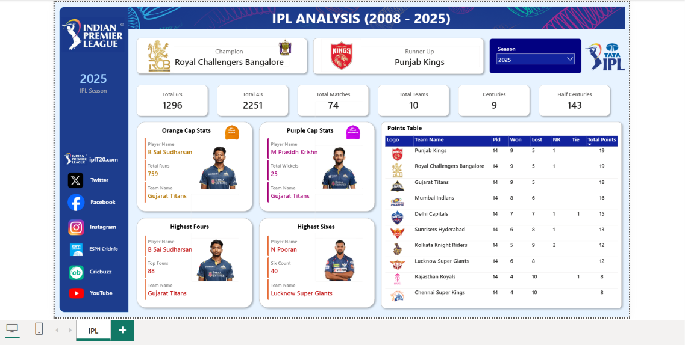

# IPL Analysis (2008–2025)

## Project Overview
This project analyzes Indian Premier League (IPL) data from 2008 to 2025 to explore team performance, player statistics, match results, and season-wise trends using SQL and Power BI.

## Project Objectives
- Analyze team performance and IPL title wins.
- Identify top-performing players and teams.
- Explore match results and season-wise trends.
- Analyze batting and bowling performance.
- Create an interactive Power BI dashboard.

## Tools & Technologies
- **SQL:** Data analysis and business queries.
- **Power BI:** Interactive dashboard and visualizations.
- **Excel:** Dataset inspection and preparation.

## Dashboard Preview

The Power BI dashboard presents IPL season statistics, champions, runners-up, Orange Cap, Purple Cap, highest fours, highest sixes, and points table.

## Repository Structure

```text
IPL-Analysis/
│
├── Dataset/
│   ├── ball_by_ball_data.csv
│   ├── ipl_matches_data.csv
│   ├── players-data-updated.csv
│   ├── teams_data.csv
│   └── README.md
│
├── SQL/
│   ├── SQL Analysis for IPL.sql
│   └── README.md
│
├── Dashboard/
│   ├── IPL ANALYSIS Dashboard.pbix
│   └── README.md
│
├── Dashboard-Screenshots/
│   ├── IPL-Dashboard.png
│   └── README.md
│
└── README.md
```

## Project Outcome
This project demonstrates practical skills in SQL-based sports data analysis, data interpretation, and Power BI dashboard development.